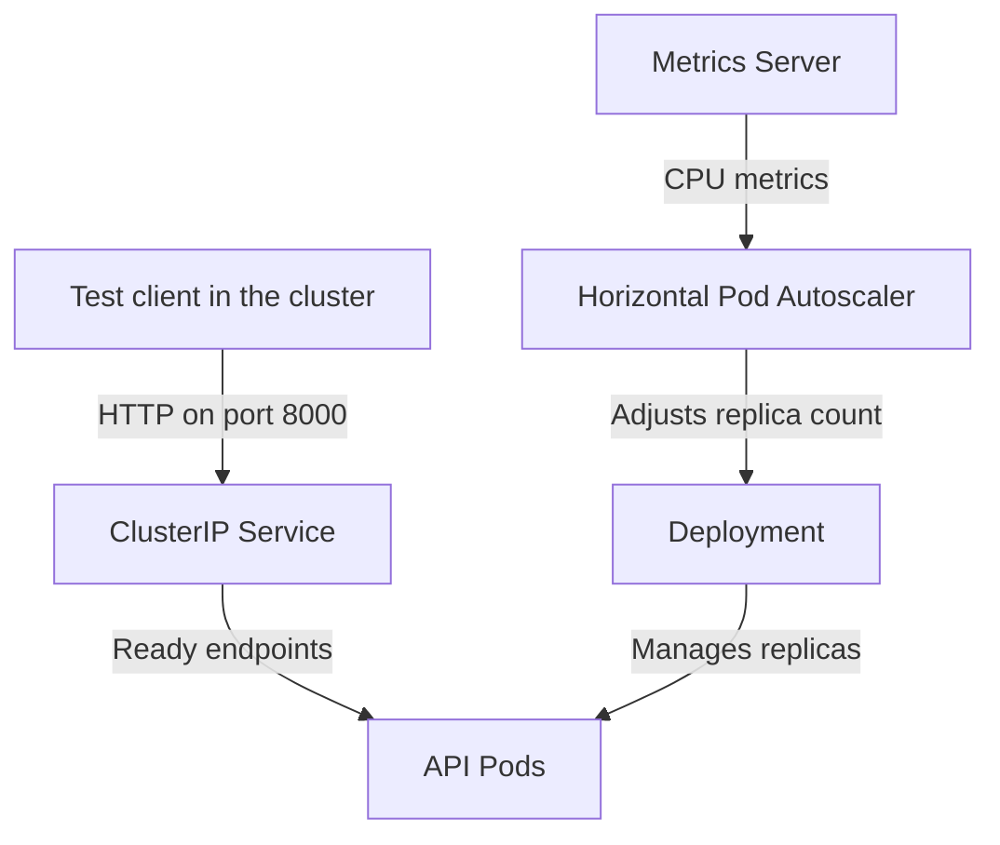

# Kubernetes Resilience Lab

[](https://github.com/defrisdoloksaribu/kubernetes-resilience-lab/actions/workflows/kubernetes-ci.yml)

A Kubernetes lab for testing Pod replacement, rolling updates, rollback after a failed readiness check, and autoscaling under HTTP load. The resilience experiments ran on Windows with Docker Desktop and a single-node kind cluster. GitHub Actions runs a separate deployment smoke test using a Python API built from this repository.

**Key result.** During a 180-second load test, the HPA scaled the API from **2 to 4 replicas** and back to **2** after the load stopped. The client recorded **26,717 successful requests and 0 failures** in that run.

## Architecture



The local Deployment starts with two replicas and checks readiness with an HTTP request to `/`. Its rolling update strategy uses `maxUnavailable: 0` and `maxSurge: 1`. For autoscaling, each API container requests `25m` CPU and has a `250m` limit. The HPA targets **50% of requested CPU**, allows **2–4 replicas**, and uses a **60-second scale-down stabilization window**.

## Experiment results

| Test | Observed result |
| --- | --- |
| Initial deployment | Both replicas became Ready. A request through the Service port-forward returned `HTTP 200`. |
| Pod replacement | After one Pod was deleted, the Deployment created a replacement and returned to `2/2` Ready. |
| Rolling update | The image changed from `resilience-api:v1` to `resilience-api:v2`, and Kubernetes reported a successful rollout. |
| Failed readiness and rollback | A new Pod stayed `0/1` Ready while the two existing Pods remained Ready. After a manual rollback, the Deployment returned to `2/2`, and the Service returned `HTTP 200` with `X-App-Version: v2`. |
| Horizontal Pod Autoscaler | Eight workers sent requests for 180 seconds. Replicas changed `2 → 3 → 4 → 3 → 2`. The client logged **26,717 successes and 0 failures**. |
| GitHub Actions | The first recorded run passed in **53 seconds**. It verified two Ready replicas and the expected HTTP status and JSON body from the independent test API. |

The request totals apply only to the autoscaling test. The rolling update had no request-count summary. The single-node lab did not test node failure or production availability.

## Quick start with the standalone API

Requires Docker, kind, and kubectl on `PATH`. Run from the repository root. On Windows, use PowerShell and Docker Desktop in Linux containers mode. **This test does not require the original v1 image.**

```powershell
docker build -t resilience-ci-api:ci ./ci/app
kind create cluster --name resilience-ci --wait 120s
kind load docker-image resilience-ci-api:ci --name resilience-ci
kubectl --context kind-resilience-ci apply -f ci/app.yaml
kubectl --context kind-resilience-ci rollout status deployment/resilience-api --timeout=120s
kubectl --context kind-resilience-ci get deployment resilience-api
kubectl --context kind-resilience-ci port-forward service/resilience-api 8080:8000
```

In a second PowerShell tab, run `curl.exe -i http://127.0.0.1:8080/`. Expect `2/2` Ready in the Deployment and `HTTP 200` with `{"status":"running","version":"ci"}` from the API. Stop the port-forward with `Ctrl+C`. If you created the disposable cluster for this test, clean up with `kind delete cluster --name resilience-ci`.

## Original Windows lab

The original `resilience-api:v1` image is **not included**. The `v2` image depends on it. If you already have `v1` in Docker Desktop, use the steps below on a local kind cluster named `resilience-lab`. Create the cluster first if it does not exist.

1. **Deploy v1.** Run `kind load docker-image resilience-api:v1 --name resilience-lab`, then `kubectl --context kind-resilience-lab apply -f k8s/app.yaml`. Verify that both replicas are Ready. The manifest uses `imagePullPolicy: Never`, so the image must already be on the node.
2. **Observe Pod replacement.** List the API Pods with `kubectl --context kind-resilience-lab get pods -l app=resilience-api`. Delete one Ready Pod in the lab and watch for a new Pod name and recovery to `2/2`.
3. **Roll out v2.** Build and load the derived image, then update the Deployment.
4. **Test rollback.** Record the healthy v2 revision. In the lab, point the readiness probe at a nonexistent path and observe the unready Pod. Restore the healthy revision with `kubectl rollout undo`, then verify two Ready replicas and the v2 response header. A rollout-status timeout does not undo the rollout automatically.
5. **Observe autoscaling.** Confirm that Metrics Server works with `kubectl --context kind-resilience-lab top pods`. Set the CPU request and limit before applying the HPA. Run an in-cluster client against `http://resilience-api:8000/` and inspect the HPA events during and after the load.

### Roll out v2

```powershell
$ctx = 'kind-resilience-lab'
docker build -t resilience-api:v2 ./v2
kind load docker-image resilience-api:v2 --name resilience-lab
kubectl --context $ctx set image deployment/resilience-api api=resilience-api:v2
kubectl --context $ctx rollout status deployment/resilience-api --timeout=120s
kubectl --context $ctx rollout history deployment/resilience-api
```

### Configure and watch the HPA

```powershell
$ctx = 'kind-resilience-lab'
kubectl --context $ctx top pods -l app=resilience-api
kubectl --context $ctx set resources deployment/resilience-api -c api --requests=cpu=25m --limits=cpu=250m
kubectl --context $ctx rollout status deployment/resilience-api --timeout=120s
kubectl --context $ctx apply -f k8s/hpa.yaml
kubectl --context $ctx get hpa resilience-api --watch
```

The [technical report](#technical-report) shows the readiness patch, rollback verification, Metrics Server troubleshooting, and load-test client. The certificate workaround documented there was limited to the local lab.

## GitHub Actions

The [Kubernetes CI workflow](.github/workflows/kubernetes-ci.yml) runs on pushes to `main`, pull requests targeting `main`, and manual dispatch. It builds `resilience-ci-api:ci`, creates a temporary kind cluster on a GitHub-hosted runner, applies the CI manifest, and checks for exactly two Ready replicas. It then calls the internal Service and verifies both HTTP status and JSON content.

The workflow **does not** connect to the Windows cluster, rerun the rollback or HPA experiments, or deploy to production.

## Repository guide

| Path | Purpose |
| --- | --- |
| [`k8s/app.yaml`](k8s/app.yaml) | Local Deployment and ClusterIP Service. |
| [`k8s/hpa.yaml`](k8s/hpa.yaml) | CPU-based autoscaling configuration. |
| [`v2/Dockerfile`](v2/Dockerfile) and [`v2/resilience_v2.py`](v2/resilience_v2.py) | Image build and middleware for the v2 response header. |
| [`ci/app.yaml`](ci/app.yaml) and [`ci/app/server.py`](ci/app/server.py) | Manifest and standalone Python API for the smoke test. |
| [`docs/`](docs/) | Technical report and screenshots embedded in the document. |

## Technical report

[Implementasi dan Pengujian Ketahanan Aplikasi pada Kubernetes (.docx)](docs/Laporan_Implementasi_dan_Pengujian_Kubernetes.docx) contains the lab procedure, test results, and 20 numbered screenshots. The images are embedded in the Word document, so the README does not require a separate screenshot directory.

Built and tested by **Defris Doloksaribu**.
